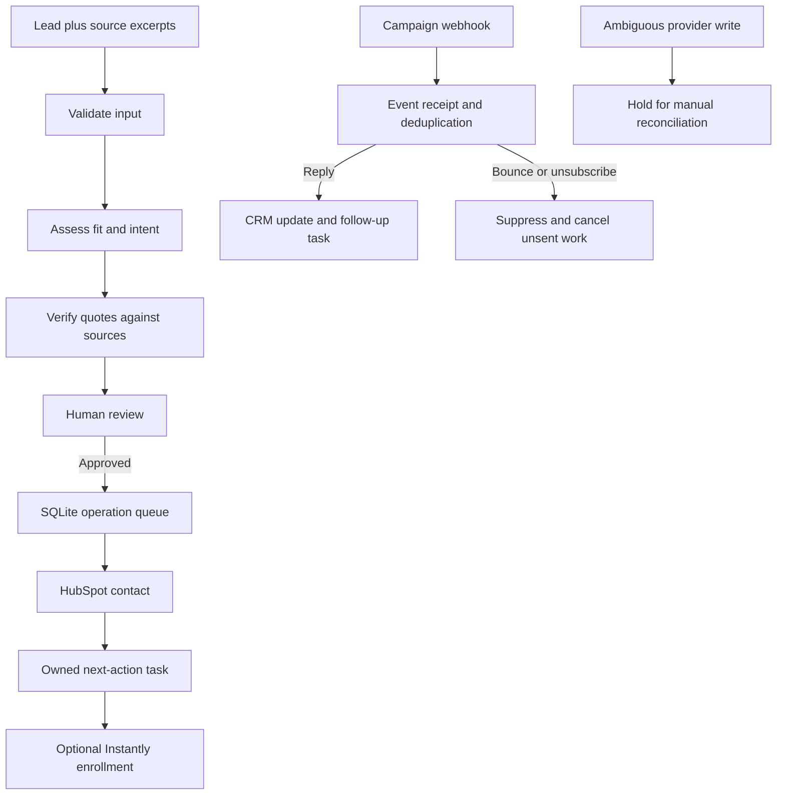

# Lead-to-CRM Automation

A property-management lead workflow that validates source-backed assessments, requires human approval, creates CRM contacts and follow-up tasks, and handles campaign events without repeating completed work.

**Status:** Local reference implementation for a fictional business. The offline demo uses supplied assessment fixtures and simulated provider receipts. HubSpot, Instantly, and Gemini adapters are implemented and tested against HTTP doubles; connected-account execution and production deployment are unverified.

## Run it

Python 3.11+; no pip packages required. Node.js is used only by the n8n forwarding-expression checks.

```powershell
python -m unittest discover -v
python demo.py
```

The demo writes `output/demo-run.json`. It proves duplicate intake, an approval, simulated contact/task/enrollment, a repeated reply, a timeout held for reconciliation, recovery after restart, and an unsubscribe cancelling unsent work. It makes no external API calls.

## How it works



1. **Intake:** Accept a JSON batch of up to 100 prospects, normalize emails, and validate source metadata. Reimporting an email never overwrites a reviewed record.
2. **Assessment:** Demo mode consumes an explicit fixture. Live mode asks Gemini to classify supplied source excerpts. The engine rejects invalid enums, missing evidence, invented references, and quotes absent from their cited excerpts. It does not discover leads, fetch websites, verify mailbox deliverability, or establish company legitimacy.
3. **Review:** A reviewer checks the sources and contact, assigns a HubSpot owner ID, and approves or rejects. High/medium fit and a literal `contact_verified: true` are required for approval. The AI cannot authorize outreach.
4. **Dispatch:** Durable operations synchronize a contact, create its owned task, and optionally enroll it in the selected Instantly campaign. Enrollment queues a CRM stage update for the next dispatch; run until no pending work remains. A campaign ID requests enrollment; `ALLOW_OUTREACH=true` is also required in live mode. Enrollment is not evidence of email delivery. This project does not activate campaigns.
5. **Events:** `reply_received` creates a follow-up task; `email_bounced` and `lead_unsubscribed` suppress the prospect. Pending enrollment is cancelled on replies or suppression. History and unique receipts prevent repeated deliveries from creating more work. Late events cannot reopen a suppressed lead.
6. **Recovery:** A possibly successful remote write is held as `uncertain`. Confirm what happened at the provider, then record the remote ID or explicitly authorize a retry after checking that no write occurred.

## n8n and the local engine

Import the inactive intake, review, event, and dispatcher JSON exports. The first three forward authenticated webhook JSON to the local engine. Run the manual dispatcher to deliver pending operations. Both the CLI and n8n use the same engine, so approval and deduplication rules do not depend on a workflow canvas.

The Python server binds only to `127.0.0.1`. For the first demo, n8n must run on the same host. No public webhook deployment is included. Connecting real Instantly delivery requires a separately hosted, authenticated n8n endpoint that can privately reach the engine. See [SETUP.md](SETUP.md).

## Files

| File | Responsibility |
| --- | --- |
| `engine.py` | Input/evidence validation, SQLite state, approval, operation queue, events, reconciliation |
| `providers.py` | Explicit demo receipts and live HubSpot/Instantly/Gemini HTTP adapters |
| `app.py` | Loopback authenticated API and request CLI |
| `demo.py` | Fixture-backed demonstration and JSON evidence |
| `n8n-*.json` | Credential-free workflow exports |
| `samples/` | Fictional inputs, approval, and campaign events |
| `test_*.py` | Engine, provider contract, API, and workflow checks |
| [SOP.md](SOP.md) | Colleague operating instructions and recovery |
| [SETUP.md](SETUP.md) | Local and connected-account configuration |
| [Design](docs/superpowers/specs/2026-10-13-lead-crm-design.md) | Scope, trade-offs, data contract, and limits |
| [Implementation plan](docs/superpowers/plans/2026-10-13-lead-crm.md) | Superpowers task sequence and verification |

## Limits and evidence

- A single operator and small batches. Provider calls hold a SQLite write lock; use leased jobs before adding concurrent workers.
- Canonical payload hashing deduplicates Instantly events without documented event IDs. Semantically equivalent payloads with changed timestamps may become distinct events.
- Source dates are retained for review; there is no automatic freshness cutoff or external authenticity check.
- HubSpot receives contact stage and assessment properties plus tasks; no deal pipeline or full CRM replacement is included. Detailed event history and failure review remain local.
- Database mode is fixed on creation. Use separate demo/live databases so simulated receipts never skip real work.
- n8n export checks verify forwarding contracts. Actual n8n import/execution must be recorded separately when a runtime is available.
- Screenshots, recordings, measured business savings, and connected-account results are not claimed by this repository.

Provider contract sources and verified request shapes are listed in [API_REFERENCES.md](docs/API_REFERENCES.md).

Verification recorded on 2026-10-13: `python -W error::ResourceWarning -m unittest discover -v` passed 38 tests; `python demo.py` completed the asserted offline walkthrough. Independent review reproduced two delivery/reconciliation defects, which were fixed and covered by regression tests. No connected-account calls, n8n runtime execution, or publication were performed.
