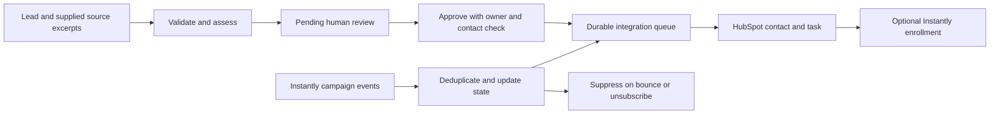

# Lead-to-CRM Automation Design

## Purpose and scope

A runnable portfolio reference implementation for a fictional property-management company. Target HubSpot for contacts and tasks, Instantly for approved campaign enrollment, and Gemini for evidence extraction. n8n orchestrates HTTP calls; a Python standard-library engine owns validation, approvals, durable state, and event deduplication. No dependencies beyond Python 3.11+ are required for the offline engine.

The user authorized brainstorming, planning, and implementation in this session and selected HubSpot. Keep this project in its own directory and local Git repository. Do not publish, contact prospects, or connect accounts during this build.

## Approaches considered

1. n8n plus a small Python/SQLite engine: selected. Testable without accounts, durable deduplication, reusable approval path.
2. n8n-only with Sheets: fewer moving parts, but spreadsheet edits are a poor boundary for atomic approval and repeated webhook processing.
3. Custom CRM and dashboard: unnecessary for demonstrating integration with an existing CRM.

## Flow

## Data and assessment contract

Input: `email`, `company`, `first_name`, `last_name`, and `sources`. Each source has `id`, `url`, `observed_at`, and `text`. Email is normalized, source IDs unique, URL HTTPS without embedded credentials, and source dates must be valid and not future dates. Bound batch size and input lengths. No network fetching of user-supplied URLs.

Assessment: `fit` (`high`, `medium`, `low`, `unknown`), `intent` (`explicit_request`, `expansion`, `none`, `unknown`), `summary`, and `evidence`. Each evidence item has `source_id` and a verbatim `quote` found in the submitted source. A substantive fit or intent classification requires evidence. Reject invented references, quotes, and enum values. Evidence matching proves traceability, not truth; humans check source authenticity. Record contact validity as syntax-only until a reviewer attests verification. No deliverability or company-legitimacy claim from AI output.

Offline assessment is supplied explicitly as a fixture. Live assessment uses Gemini with a JSON schema and revalidates the result locally. The source text is untrusted data, never an instruction to approve or send outreach.

## Approval and CRM mapping

Import inserts new emails only; repeats do not overwrite reviewed records. A reviewer supplies their name, an owner ID, a decision (`approve` or `reject`), a note, and `contact_verified: true` when approving. Only high/medium-fit records can be approved. Approval creates durable operations for contact sync and a next-action task. Campaign enrollment is separately requested with a campaign ID and allowed only after the CRM operations complete.

HubSpot uses default contact properties plus documented custom string properties for local stage, fit, intent, assessment summary, and evidence. Do not overwrite HubSpot lifecycle stages. Tasks are associated to the contact and assigned to the selected owner. Local SQLite retains the detailed approval and event audit; the CRM gets a useful summary and next action.

## State, errors, and delivery

SQLite stores lead JSON, unique operation keys, unique event receipts, and a failure review queue. Database metadata fixes demo/live mode so demo deliveries cannot be mistaken for live receipts. Transactions protect import, approval, and event changes. A serialized dispatcher processes durable operations in order and stores successful remote IDs.

Duplicate approvals and webhook deliveries create no additional work. Unknown leads and conflicting event IDs are rejected into review. Reply creates a follow-up task; bounce and unsubscribe suppress locally immediately and cancel pending enrollment. Suppression is permanent in this version; late sent/reply events cannot reopen outreach. Event history records provider timestamps, while terminal state is monotonic.

Mark operations `processing` before sending. On restart or an ambiguous write timeout, hold them as `uncertain` and require explicit reconciliation with the provider; never automatically repeat a possibly successful task or enrollment. Known failures can be retried after correction. Suppression operations take priority over pending enrollment. Queue operations consume current lead state so old CRM updates cannot undo suppression.

## Interfaces and tools

- `Engine(db_path, provider)`: `ingest(records)`, `review(email, decision, reviewer, owner_id, note, contact_verified=False, campaign_id=None)`, `event(payload)`, `dispatch()`, `snapshot()`, `reconcile(key, remote_id=None, retry=False)`.
- Provider: `mode`, `assess(lead) -> dict`, `execute(kind, lead, payload) -> dict` returning an `id` for contact/task/enrollment operations.
- Local authenticated HTTP endpoints: POST `/ingest`, `/review`, `/events`, `/dispatch`, `/reconcile`; GET `/state`. Bind to loopback only. Require a shared bearer token for every endpoint. Do not expose the standard-library server publicly.
- CLI: offline demo, server, and JSON request commands. Keep credentials in environment variables.
- Three n8n webhook exports forward intake, reviewer decisions, and campaign events through header-auth credentials to the engine. A fourth manual dispatcher export delivers the pending queue. No embedded keys or real IDs. Event normalization is performed by the engine. Enrollment success queues a CRM stage update for the next dispatch.

## Verification and evidence

Test real SQLite state and HTTP behavior: invalid input, grounded evidence, duplicates, approval gates, task/enrollment order, repeated and conflicting events, suppression, partial delivery, restart recovery, reconciliation, provider payloads, authentication, body limits, and n8n forwarding contracts. Use local HTTP doubles for external provider contract tests. Record the fixture-backed demonstration as JSON and terminal output. Label n8n structural checks separately from actual import/execution.

## Limits

Single operator and small batches; a serialized dispatcher holds one SQLite transaction while calling providers. `ponytail:` ceiling is low throughput; move remote calls into leased jobs before multi-worker use. No prospect discovery crawler, third-party email verification, CRM deal pipeline, production deployment, or public UI in this version. Supply sources manually, review contacts manually, and use contact stage fields for the first demo. Connected account execution remains a separate verification step.
